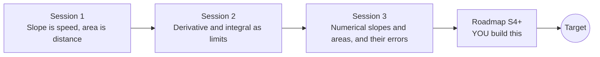

# opencalculus

[](https://github.com/KrunalPanchal1995/opencalculus/actions/workflows/ci.yml)   [](https://colab.research.google.com/github/KrunalPanchal1995/opencalculus/blob/main/sessions/session-01/lesson.ipynb) [](https://krunalpanchal1995.github.io/opencalculus/)

**See derivatives and integrals as slopes and areas on a moving car's graph.**

opencalculus teaches derivatives and integrals as slopes and areas, from a car's distance graph to numerical methods whose errors you measure, using only Python and a browser.

- **Start from a car.** Session 1 needs only a speed graph and school arithmetic; slope and area are explained from scratch.
- **See it move.** Every session ships a slider app that runs in the browser, with labelled graphs and units.
- **Know you got it right.** Each session ends with a checkpoint that prints PASS or FAIL against hand calculations and exact answers.
- **Build the missing half.** The repo stops at Session 3 on purpose; the roadmap shows the path to the Target.

[Target](#the-target) · [Who is this for](#who-is-this-for) · [Quick start](#quick-start) · [Sessions](#sessions) · [Roadmap](#roadmap) · [Contribute](#contribute) · [Explainer PDF](docs/explainer.pdf)

> **This repo is incomplete on purpose.** Sessions 1 to 3 are here and fully working. The finished Target below is a preview of what the community can build next. We show you the path, not the code. Sessions 4 and up are yours.

## The Target

A car's speed curve is drawn with its derivative (acceleration) and its integral (distance) traced live as a point moves along it: the tangent shows the slope, the shaded area grows into the distance. Beside it, a convergence plot shows how the error of four numerical methods falls with the step, on lines of slope 1, 2, 2 and 4. Your goal over the coming sessions: build that animation yourself, with your own numerical derivative and integral of any function you type in.


*Target: speed, its derivative and integral traced live, with a convergence plot*

- [Riemann sums: thin pieces add up to an integral (video)](promo/media/riemann_sums.mp4)

- [Chords approach a curve as they get shorter (video)](promo/media/chords_to_curve.mp4)

Try it live:

- [Math Visual Studio: limits and continuity (Atlas S08)](https://krunalpanchal1995.github.io/studio/#atlas?ch=S08&ex=1)
- [Math Visual Studio: differential calculus (Atlas S09)](https://krunalpanchal1995.github.io/studio/#atlas?ch=S09&ex=1)
- [Math Visual Studio: integral calculus (Atlas S10)](https://krunalpanchal1995.github.io/studio/#atlas?ch=S10&ex=1)

How the Target was made is shown only as a path in [promo/roadmap.md](promo/roadmap.md).

## Who is this for
**secondary school to diploma / undergraduate (levels 3-5).** Topic area: Mathematics and Visual Problem-Solving.

Prerequisites:

- Reading a graph and the idea of speed = distance / time (school level).
- Python 3.10 or newer; if `python --version` works, you are ready. PRIMER.md explains the rest.
- No prior calculus, GitHub or numerical-methods experience is needed; Session 2 introduces the limit idea gently.

New to Python? Read [PRIMER.md](PRIMER.md) first (10 minutes).

## Quick start

No installation knowledge needed. You need [Git](https://git-scm.com/downloads) and [Python 3.10+](https://www.python.org/downloads/) (Windows: tick "Add Python to PATH"). On Mac and Linux type `python3` wherever this page says `python`.

```bash
git clone https://github.com/KrunalPanchal1995/opencalculus.git
cd opencalculus
python start.py 1
```

`start.py` creates a private environment, installs what is needed and runs Session 1 with its checkpoint. Next: `python start.py 2`, `python start.py 3`, or `python start.py test` to check everything. Only a checkpoint: `python start.py check 1`.

Four lines turn the idea of Session 1 into a result (they work as they are): Save it as `try.py` and run it with `python start.py run try.py` (this uses the private environment, where NumPy is installed):

```python
import numpy as np
t = np.linspace(0, 2, 2001)
v = 6 * t + 2                                    # speed (m/s) of a car with x = 3 t^2 + 2 t
print(round(float(np.sum((v[1:] + v[:-1]) / 2 * np.diff(t))), 3))   # area = distance -> 16.0
```

Every session also opens in your browser with sliders (no install): [live apps](https://krunalpanchal1995.github.io/opencalculus/). Or use the Colab badge above for the notebook.

## Sessions

| # | Session | Model level | Time | Live app |
|---|---|---|---|---|
| 1 | [Slope is speed, area is distance](sessions/session-01/README.md) | Level 1: conceptual interactive model | 60 min | [open](https://krunalpanchal1995.github.io/opencalculus/session-01/) |
| 2 | [Derivative and integral as limits](sessions/session-02/README.md) | Level 2: mathematical engineering model | 75 min | [open](https://krunalpanchal1995.github.io/opencalculus/session-02/) |
| 3 | [Numerical slopes and areas, and their errors](sessions/session-03/README.md) | Level 3: simulation and validation | 90 min | [open](https://krunalpanchal1995.github.io/opencalculus/session-03/) |

Each session follows the same six steps: A real-world problem, B concept and theory, C visual explanation, D interactive simulation, E worked example and experiment, F assessment and design challenge. Each ends with `checkpoint.py`, which prints `PASS` or `FAIL` against reference numbers. Session 3 also contains the real-world mini-project: **Reconstruct the distance travelled from a noisy speedometer log**.

## Architecture



| Folder or file | What is inside |
|---|---|
| `sessions/` | three sessions: README (A-F), `lesson.py`, notebook, live app, exercises, activity sheet, checkpoint |
| `promo/` | the Target: media, live links, and the roadmap (path only) |
| `docs/` | `explainer.tex` and the built `explainer.pdf` |
| `tests/` | runs every lesson and checkpoint headless |
| `start.py` | one command to set up and run anything |
| `QUALITY.md`, `RUBRIC.md` | the quality checklist and the scoring rubric |
| `.github/` | CI, PDF build, Pages deploy, issue and PR templates |

## Roadmap

| Milestone | What you will build | Difficulty |
|---|---|---|
| Session 4: Romberg integration | A Romberg table that builds higher-order rules from the trapezoid rule. | intermediate |
| Session 5: Gaussian quadrature | A Gauss-Legendre integrator with a handful of nodes. | intermediate |
| Session 6: Derivatives without subtraction | A derivative routine that avoids the round-off limit of Session 3. | advanced |
| Session 7: Derivatives of noisy data | A smoothing differentiator for the speedometer log of the mini-project. | advanced |
| Session 8: Solve the braking ODE | A solver for a braking car with drag, v' = -c v^2, and the distance it travels. | advanced |

Full detail with a checkpoint per milestone: [promo/roadmap.md](promo/roadmap.md).

## Contribute
New to GitHub? Read [CONTRIBUTING.md](CONTRIBUTING.md); it starts from zero. Pick an issue labelled `good first issue`. Translations into Hindi, Telugu, Tamil and Malayalam are welcome.

<details>
<summary>Development</summary>

```bash
python start.py test        # runs every lesson and checkpoint
```
Lessons use `# %%` cell markers so they open as notebooks in VS Code. See [QUALITY.md](QUALITY.md) for the standard every session meets.
</details>

## License
MIT. See [LICENSE](LICENSE). Media in `promo/media` is (c) Krunal Panchal, CC BY 4.0.

## Acknowledgments
Part of the [PAN IIT OSS](https://hellofoss.tech-iitb.org/projects) open-source teaching collection, modelled on the structure of [openspline](https://github.com/openspline/openspline). Built on ideas from the Math Visual Studio at https://krunalpanchal1995.github.io/studio/.
