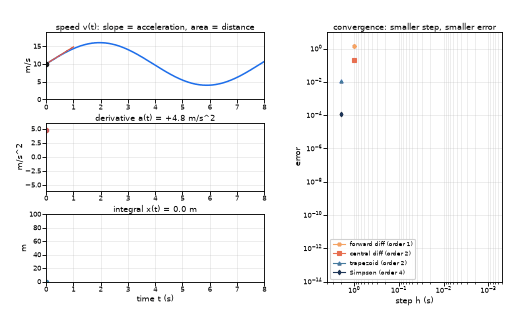

# What you are building toward

A car's speed curve is drawn with its derivative (acceleration) and its integral (distance) traced live as a point moves along it: the tangent shows the slope, the shaded area grows into the distance. Beside it, a convergence plot shows how the error of four numerical methods falls with the step, on lines of slope 1, 2, 2 and 4. Your goal over the coming sessions: build that animation yourself, with your own numerical derivative and integral of any function you type in.

*Target: speed, its derivative and integral traced live, with a convergence plot*

- [Riemann sums: thin pieces add up to an integral (video)](media/riemann_sums.mp4)

- [Chords approach a curve as they get shorter (video)](media/chords_to_curve.mp4)

These results come from a private reference build. The code is not published; the roadmap shows the path so you can build your own.

Live links:

- [Math Visual Studio: limits and continuity (Atlas S08)](https://krunalpanchal1995.github.io/studio/#atlas?ch=S08&ex=1)
- [Math Visual Studio: differential calculus (Atlas S09)](https://krunalpanchal1995.github.io/studio/#atlas?ch=S09&ex=1)
- [Math Visual Studio: integral calculus (Atlas S10)](https://krunalpanchal1995.github.io/studio/#atlas?ch=S10&ex=1)
