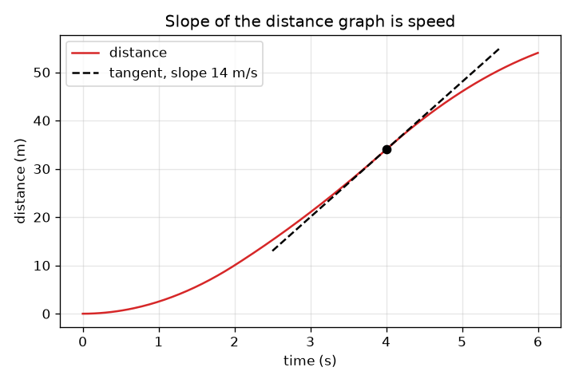
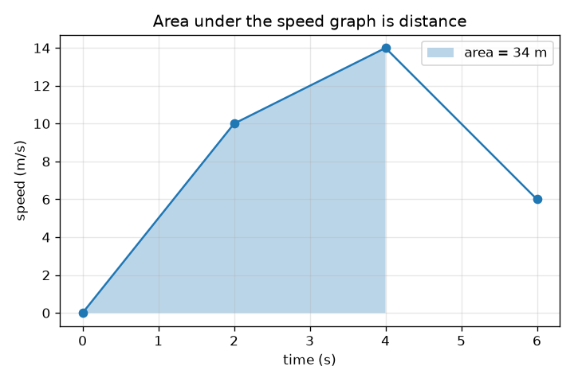

# Session 1: Slope is speed, area is distance

*Level 1 (conceptual interactive model) · about 60 minutes · opencalculus*

> This is a simplified educational model. It is not a validated design tool and must not be used for real structures, electrical installations, vehicles, industrial processes or medical decisions.

**Prerequisites**

- Speed = distance / time and reading a graph (school level).
- You have read PRIMER.md and run `python start.py 1` once.

**Learning objectives.** After this session you can:

- Explain why the slope of a distance-time graph is the speed.
- Explain why the area under a speed-time graph is the distance travelled.
- Compute the distance for a piecewise straight speed graph by adding trapezoids.
- Move between the two graphs of the same journey in both directions.

## A. Real-world problem
A car's speedometer tells you how fast you go but not how far you have come; its odometer tells you how far but not how fast. If you only had a record of one of them, could you rebuild the other? That question is the whole of calculus in disguise: going from distance to speed is differentiation, going from speed to distance is integration. In this session you do both with nothing but slopes and areas.

## B. Concept and theory
Speed is distance divided by time. On a distance-time graph, 'distance divided by time' is rise over run, the slope. When the speed changes, the slope changes from moment to moment: the speed at a moment is the slope of the tangent line touching the curve there. Going the other way, distance equals speed times time. On a speed-time graph that is width times height, the area of a rectangle; if the speed changes we cut the time into slices and add up the areas (a trapezoid for a straight-line change). The unit of the area is s * m/s = m. Our car starts at rest and its speed is known at 0, 2, 4 and 6 s, with straight lines in between.

| Symbol | Meaning | Unit |
|---|---|---|
| t | time since the start | s |
| v(t) | speed of the car at time t | m/s |
| x(t) | distance travelled since the start, up to time t | m |
| slope | rise over run of the distance graph | m/s |
| area | area under the speed graph | m |

**Assumptions**

- The car moves along a straight road and never reverses, so speed and distance only grow in the direction of travel.
- Between the four known moments the speed changes in a straight line.
- The car starts at rest at x = 0 and t = 0.

$$ v=\frac{\Delta x}{\Delta t}\quad\text{(slope of the distance graph)} $$

$$ \Delta x=\frac{v_1+v_2}{2}\,\Delta t\quad\text{(area of one trapezoid under the speed graph)} $$

$$ x(t)=\text{area under }v\text{ from }0\text{ to }t,\qquad v(t)=\text{slope of }x\text{ at }t $$

## C. Visual explanation
The left figure shows speed against time for a car with speeds 10, 14 and 6 m/s at 2, 4 and 6 s; the shaded area up to 4 s is 34 m. The right figure shows distance against time for the same car: the curve rises steeply where the speed is high and the dashed tangent at 4 s has a slope of 14 m/s, the speed read from the other graph. A flat piece of the speed graph is a straight, steady piece of the distance graph; a rising piece of the speed graph is a distance curve that bends upwards.

*Distance against time: the tangent at 4 s has slope 14 m/s, the speed.*

*Speed against time: the shaded area up to 4 s is the distance, 34 m.*

## D. Interactive simulation
Run the lesson (`python start.py 1`), then open the live app: [Session 1: slope is speed, area is distance](https://krunalpanchal1995.github.io/opencalculus/session-01/) (or `app.html` in this folder). Drag the three speed sliders to reshape the speed curve and watch the car on the road, then open the distance view and move the time slider: the red tangent line always has slope equal to the speed. Compare the shaded area in the speed view with the distance in the readout.

**Challenge.** Make the car cover at least 90 m in the 6 s without ever going faster than 20 m/s.

## E. Worked example and experiment
**Problem.** A car starts at rest and has speeds 10, 14 and 6 m/s at t = 2, 4 and 6 s, with straight lines between. Find the distance at each of those times, then the speed at t = 3 s and the slope of the distance graph there.

1. Slice 1 (0 to 2 s): trapezoid with sides 0 and 10 m/s and width 2 s: (0 + 10)/2 * 2 = 10 m.
2. Slice 2 (2 to 4 s): (10 + 14)/2 * 2 = 24 m, so the distance at 4 s is 10 + 24 = 34 m.
3. Slice 3 (4 to 6 s): (14 + 6)/2 * 2 = 20 m, so the distance at 6 s is 54 m.
4. Speed at t = 3 s: half way between 10 and 14 m/s is 12 m/s.
5. Slope of the distance graph at 3 s: the distance changes by about 12 m for each second there, so the slope is 12 m/s, the same number. Unit check: m / s = m/s.

**Answer.** Distances 10 m, 34 m and 54 m at 2, 4 and 6 s; speed 12 m/s at 3 s, equal to the slope of the distance graph there.

**Experiment.** Roll a toy car or walk along a corridor with a stopwatch and tape measure, noting the position every second. Plot distance against time, estimate the slopes between neighbouring points and compare them with the speed you felt. The numbers will be a little rough: stopwatch reaction time is about 0.2 s and the model assumes perfectly straight-line speed changes between known moments, which a real car does not obey exactly.

## F. Assessment and design challenge
**Question type A: Conceptual.** A friend says 'the speed graph is flat, so the car is not moving'. Is that right? What does a flat distance graph mean?

Hint

Read the height of the speed graph, not its steepness, and remember slope = speed.

Step-by-step solution

No. A flat speed graph at 10 m/s means a constant speed of 10 m/s: the car is moving steadily, its distance graph is a straight sloped line (slope 10 m/s). A flat distance graph means the distance is not changing, so the speed is zero and the car is stopped. 'Flat' means different things on the two graphs: the speed graph shows the speed itself, the distance graph shows it only through its slope.

**Question type B: Numerical.** A car has speeds 0, 12, 12 and 6 m/s at t = 0, 2, 4 and 6 s, with straight lines between. Find the total distance in 6 s and the average speed. Check the units.

Hint

Add three trapezoids; average speed is total distance divided by total time.

Step-by-step solution

Slice 1: (0 + 12)/2 * 2 = 12 m. Slice 2: (12 + 12)/2 * 2 = 24 m. Slice 3: (12 + 6)/2 * 2 = 18 m. Total = 54 m. Average speed = 54 m / 6 s = 9 m/s. Sanity check: the speed is always between 0 and 12 m/s, so 9 m/s is a believable average. Units: m/s * s = m.

**Question type C: Graph and simulation interpretation.** In the distance graph of the car from the worked example (speeds 10, 14, 6 m/s), where is the curve steepest and what is its slope there? What is the slope at the end, t = 6 s?

Hint

The slope of the distance graph at a time equals the speed at that time.

Step-by-step solution

The curve is steepest at t = 4 s where the speed peaks at 14 m/s, so the slope is 14 m/s. At t = 6 s the speed is 6 m/s, so the slope has dropped to 6 m/s: the curve is still rising but much more gently. The distance never goes down because the speed is never negative.

**Question type D: Design and optimisation challenge.** Design: choose the speeds at 2, 4 and 6 s (each at most 20 m/s, the limit of this exercise) so that the car covers at least 90 m in 6 s. Find a choice that works and one that fails, and say what you would trade off.

Hint

The total distance is 2 v1 + 2 v2 + v3 (three trapezoids). Try the largest speeds first.

Step-by-step solution

Total = 2 v1 + 2 v2 + v3. With 20, 20, 20: 40 + 40 + 20 = 100 m, which works. With 20, 20, 10: 90 m, just enough. With 15, 15, 15: 30 + 30 + 15 = 75 m, which fails. The first two speeds count double because they belong to two slices each, so being fast early matters most; the trade-off is that finishing at 20 m/s leaves less margin for stopping. Assumption: straight-line speed changes, no reversing.

Score yourself with [RUBRIC.md](../../RUBRIC.md). Print the [activity sheet](activity_sheet.md) to work on paper.

## Common misconceptions
| Common misconception | What is actually true |
|---|---|
| A flat speed graph means the car is stopped. | A flat speed graph at height 10 m/s means a steady 10 m/s. The car is stopped only when the speed graph is at zero, or the distance graph is flat. |
| Higher on the distance graph means faster. | Steeper on the distance graph means faster. The height of the distance graph is how far you are, the slope is how fast you go. |
| The area under a speed-time graph is a speed. | Area = width * height = s * m/s = m: it is a distance. The units tell you what a quantity is. |
| Slope only makes sense for straight lines. | A curve has a slope at every point: the slope of the tangent line that just touches it there. |

## Glossary
- **slope**: rise over run: how much the vertical value changes for each unit across
- **tangent line**: the straight line that touches a curve at one point and has the same slope as the curve there
- **trapezoid**: a four-sided shape with two parallel sides; its area is the average of the parallel sides times the width
- **speed**: how fast the distance changes, in m/s
- **distance travelled**: the total length covered along the road, in m

## Finish
1. Do the three coding tasks in [exercises.md](exercises.md).
2. Run `python start.py 1` again after your changes. It ends with the checkpoint; when it prints `PASS`, you are done. (Checkpoint only: `python start.py check 1`.)

Next: [Session 2](../session-02/README.md)
