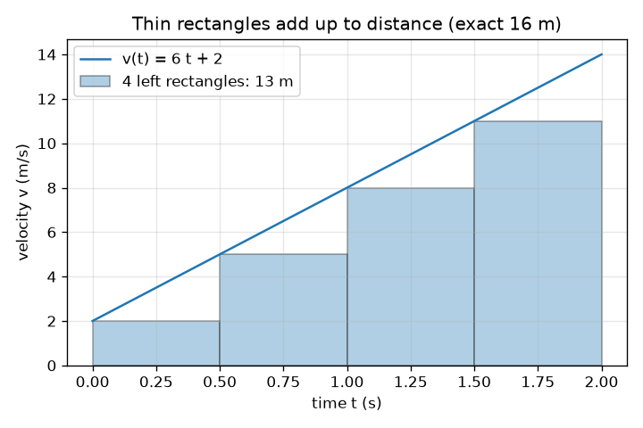
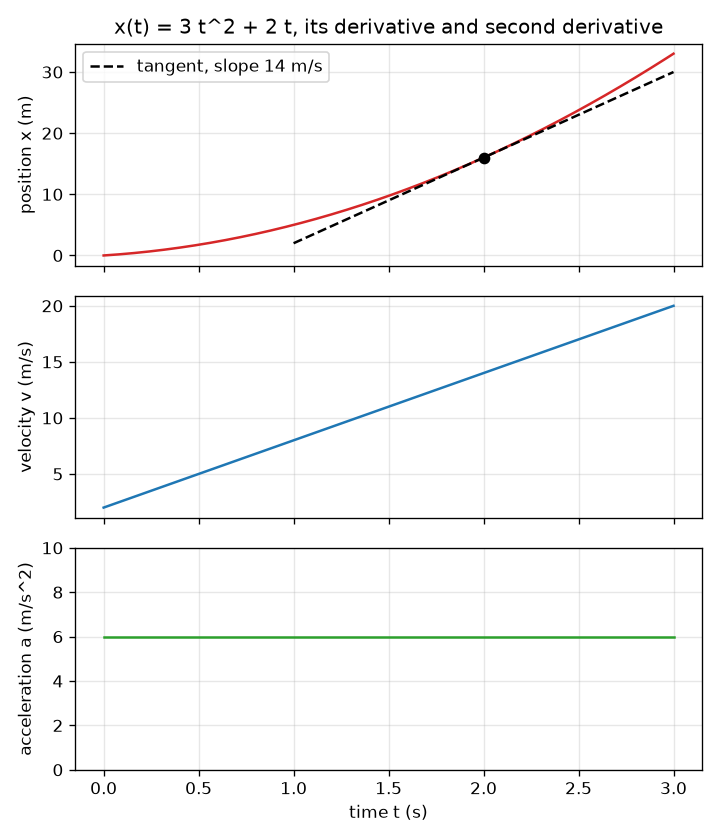

# Session 2: Derivative and integral as limits

*Level 2 (mathematical engineering model) · about 75 minutes · opencalculus*

> This is a simplified educational model. It is not a validated design tool and must not be used for real structures, electrical installations, vehicles, industrial processes or medical decisions.

**Prerequisites**

- Session 1: slope is speed, area is distance.
- Powers such as t^2 and the idea of a function; the limit idea is introduced in Section B.

**Learning objectives.** After this session you can:

- Compute a secant slope, shrink the gap and see it settle on the derivative.
- Differentiate polynomials, sin and exp by the rules, and check a rule with finite differences.
- Approximate an integral by thin rectangles and see the error shrink as they get thinner.
- State the fundamental theorem and use it to check units and answers.
- Solve a design problem: the stopping distance of a braking car.

## A. Real-world problem
A car's position is x(t) = 3 t^2 + 2 t metres, with t in seconds. What are its velocity and acceleration at 2 s, and are the units of every term sensible? Then a harder question: when a driver brakes, how far does the car go before it stops, and how fast can it be going if it must stop within 40 m?

## B. Concept and theory
The slope between two moments t and t + h is the secant slope (x(t + h) - x(t)) / h. As h gets smaller the secant slope settles on one number: the derivative x'(t), the slope of the tangent line. This 'settling' is called a limit. For x = 3 t^2 + 2 t at t = 2 the secant slope is 14 + 3 h, which tends to 14 m/s as h tends to 0. Rules: the derivative of c t^n is c n t^(n-1); of sin t is cos t; of e^t is e^t. Velocity is the derivative of position and acceleration is the derivative of velocity. For the integral, cut [a, b] into n slices of width dt = (b - a)/n and add up (height) * dt for each slice; as n grows the sum settles on the integral. The fundamental theorem says the integral of v from a to b equals x(b) - x(a) when v = x', so differentiating and integrating undo each other. Units: each term of x = 3 t^2 + 2 t must be in metres, so the 3 is in m/s^2 and the 2 in m/s. Braking: a steady slowdown a means the speed falls linearly from v0 to 0 in T = v0 / a, and the distance is the area of the triangle v0 T / 2 = v0^2 / (2 a). This is a simplified model: real braking depends on tyres, road and load and is not personal driving advice.

| Symbol | Meaning | Unit |
|---|---|---|
| x(t) | position of the car | m |
| v(t) = x'(t) | velocity | m/s |
| a = v'(t) | acceleration | m/s^2 |
| h | gap between the two moments of a secant | s |
| n, dt | number and width of rectangles | no unit, s |
| v0 | speed when braking starts | m/s |
| t_r | driver reaction time before braking starts | s |

**Assumptions**

- The car moves along a straight line.
- Braking is a steady slowdown (the speed drops in a straight line).
- During the reaction time the car keeps its speed v0.
- Functions are smooth: they have a tangent line at every point we use.

$$ x'(t)=\lim_{h\to 0}\frac{x(t+h)-x(t)}{h} $$

$$ \frac{d}{dt}\left(c\,t^n\right)=c\,n\,t^{n-1},\qquad \frac{d}{dt}\sin t=\cos t,\qquad \frac{d}{dt}e^t=e^t $$

$$ \int_a^b v(t)\,dt\approx\sum_{k=0}^{n-1}v(t_k)\,\Delta t,\qquad \Delta t=\frac{b-a}{n} $$

$$ \int_a^b x'(t)\,dt=x(b)-x(a) $$

$$ d_{\mathrm{stop}}=v_0\,t_r+\frac{v_0^2}{2a} $$

## C. Visual explanation
The first figure stacks x(t) = 3 t^2 + 2 t, its derivative v(t) = 6 t + 2 and its second derivative a = 6: the position curve bends upwards, the velocity is a straight rising line and the acceleration is flat. The second figure shows v(t) on [0, 2] with four left rectangles; they add up to 13 m, a little below the exact 16 m, because the rising curve lies above each rectangle's top-left corner. With 16 rectangles the sum is 15.25 m and with 64 it is 15.8125 m: closing in on 16.

*Four left rectangles under v = 6 t + 2: 13 m against the exact 16 m.*

*x(t) = 3 t^2 + 2 t with its derivative v = 6 t + 2 and acceleration 6 m/s^2.*

## D. Interactive simulation
Run the lesson (`python start.py 2`), then open the live app: [Session 2: function, derivative and integral](https://krunalpanchal1995.github.io/opencalculus/session-02/) (or `app.html` in this folder). Change A and B and watch x, v and a in the readout. In the position view, drag the gap h down towards 0.1 and see the grey secant line merge with the red tangent. In the velocity view, raise n and watch the rectangle sum approach x(t).

**Challenge.** Find A and B so that the car is at least 50 m from the start at t = 4 s while its acceleration stays at or below 4 m/s^2.

## E. Worked example and experiment
**Problem.** For x(t) = 3 t^2 + 2 t (metres), find the velocity and acceleration at t = 2 s with units, check the derivative with secant slopes, and check the fundamental theorem on [0, 2] with rectangles.

1. Position: x(2) = 3 * 4 + 2 * 2 = 12 + 4 = 16 m.
2. Velocity by the rule: v(t) = 6 t + 2, so v(2) = 14 m/s. Units: 6 is m/s^2 and times t (s) gives m/s; 2 is m/s.
3. Acceleration: a = v' = 6 m/s^2, constant.
4. Secant check at t = 2: slope = (x(2 + h) - x(2)) / h = 14 + 3 h, so h = 1 gives 17, h = 0.1 gives 14.3, h = 0.001 gives 14.003: tending to 14 m/s.
5. Fundamental theorem: the integral of v from 0 to 2 equals x(2) - x(0) = 16 m. Four left rectangles of width 0.5 s: heights v(0), v(0.5), v(1), v(1.5) = 2, 5, 8, 11 m/s, sum 26 * 0.5 = 13 m (below 16, as the curve rises); four midpoint rectangles give 16 m exactly because v is a straight line.

**Answer.** x(2) = 16 m, v(2) = 14 m/s, a = 6 m/s^2; the secant slopes tend to 14 m/s and the rectangle sums tend to 16 m.

**Experiment.** Drop a ball past a metre stick filmed at 30 frames per second, read its position in each frame and fit x = c t^2: the fitted 2c should come out near 9.8 m/s^2. Differences between model and reality come from reading positions off a video (a few millimetres), air drag, and a start time you cannot read exactly; the model x = 3 t^2 + 2 t is exact only for its own idealised car.

## F. Assessment and design challenge
**Question type A: Conceptual.** Why does the secant slope never equal the tangent slope exactly for h > 0, and why is it still useful to compute it?

Hint

Where does the secant line touch the curve, and what does a limit do?

Step-by-step solution

The secant line touches the curve at two points, so it measures the average slope over the gap h; the tangent line touches at one point. For x = 3 t^2 + 2 t at t = 2 the secant slope is 14 + 3 h, which is never 14 for h > 0. But it gets as close as we like by making h small, and that limit is the derivative. Computing secants is how computers estimate derivatives when no formula is known (Session 3).

**Question type B: Numerical.** For x(t) = 5 t^2 + 4 t (metres), find x, the velocity and the acceleration at t = 3 s, with units, and check that the units of the two coefficients make sense.

Hint

Use d/dt of c t^n = c n t^(n-1) twice.

Step-by-step solution

x(3) = 5 * 9 + 4 * 3 = 45 + 12 = 57 m. v(t) = 10 t + 4, so v(3) = 34 m/s. a = 10 m/s^2. Units: x is in m, so 5 is m/s^2 (m/s^2 * s^2 = m) and 4 is m/s (m/s * s = m). v = 10 t + 4 then has 10 in m/s^2 and 4 in m/s: m/s^2 * s = m/s. All terms are consistent.

**Question type C: Graph and simulation interpretation.** In the position view with A = 3, B = 2, t = 2, the secant slope with gap h = 2 s is shown. What value do you read, and what happens when you reduce h to 0.1?

Hint

The secant slope equals v + A h.

Step-by-step solution

With v = 14 m/s and A = 3 m/s^2 the secant slope is 14 + 3 * 2 = 20 m/s; with h = 0.1 it is 14.3 m/s. The secant line rotates towards the red tangent line as h shrinks. The secant is steeper than the tangent because the curve bends upwards (positive acceleration).

**Question type D: Design and optimisation challenge.** Design: a driver has a reaction time of 0.75 s and the car brakes at a steady 6 m/s^2. What is the stopping distance from 25 m/s (90 km/h)? What is the largest speed that stops within 40 m? State two things this simple model leaves out.

Hint

Use d = v0 t_r + v0^2 / (2 a). For the second part solve v t_r + v^2 / (2 a) = 40 for v.

Step-by-step solution

From 25 m/s: reaction distance 25 * 0.75 = 18.75 m and braking distance 625 / 12 = 52.08 m, total about 70.8 m, far more than 40 m. For 40 m: v^2 / 12 + 0.75 v - 40 = 0, i.e. v^2 + 9 v - 480 = 0, so v = (-9 + sqrt(81 + 1920)) / 2 = 17.87 m/s, about 64 km/h. Check: 17.87 * 0.75 + 17.87^2 / 12 = 13.4 + 26.6 = 40 m. The model leaves out that real deceleration depends on tyres, road surface, slope and load, and that reaction times vary; it is a classroom model, not driving advice. The braking part grows as v^2, so doubling the speed quadruples it.

Score yourself with [RUBRIC.md](../../RUBRIC.md). Print the [activity sheet](activity_sheet.md) to work on paper.

## Common misconceptions
| Common misconception | What is actually true |
|---|---|
| The derivative is the slope between two points. | That is the secant slope. The derivative is the limit as the two points merge: the slope of the tangent line. |
| More rectangles always means the sum is exactly the integral. | More rectangles gives a better approximation; the exact value is the limit. For a straight-line v the midpoint sum is exact, the left sum is not. |
| Velocity and acceleration have the same unit. | Velocity is m/s, acceleration is m/s^2: differentiating divides the unit by seconds again. |
| Doubling the speed doubles the braking distance. | Braking distance grows as v^2, so doubling the speed quadruples it (the reaction part only doubles). |

## Glossary
- **derivative**: the limit of secant slopes as the gap shrinks to zero; the slope of the tangent line
- **secant line**: a straight line through two points of a curve
- **limit**: the value a quantity settles on as another quantity shrinks towards zero
- **Riemann sum**: the sum of (height * width) over thin rectangles, an approximation of an integral
- **integral**: the limit of Riemann sums: the exact area under a curve
- **fundamental theorem**: integrating the derivative of a function gives back the change in the function

## Finish
1. Do the three coding tasks in [exercises.md](exercises.md).
2. Run `python start.py 2` again after your changes. It ends with the checkpoint; when it prints `PASS`, you are done. (Checkpoint only: `python start.py check 2`.)

Next: [Session 3](../session-03/README.md)
