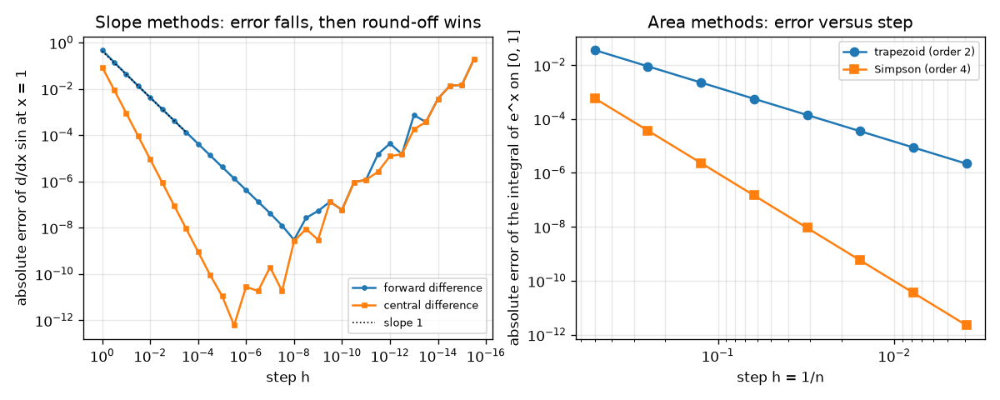
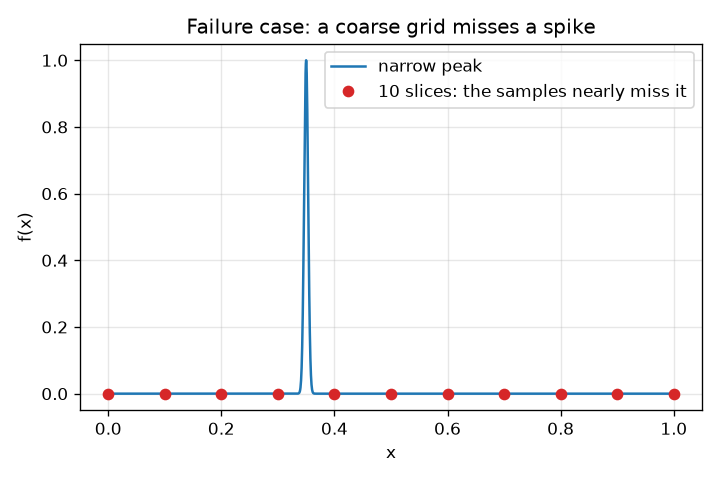

# Session 3: Numerical slopes and areas, and their errors

*Level 3 (simulation and validation) · about 90 minutes · opencalculus*

> This is a simplified educational model. It is not a validated design tool and must not be used for real structures, electrical installations, vehicles, industrial processes or medical decisions.

**Prerequisites**

- Session 2: derivative and integral as limits.
- Reading log-log graphs: a straight line of slope p means error proportional to h^p (explained in Section B).

**Learning objectives.** After this session you can:

- Implement forward and central differences, the trapezoid rule and Simpson's rule.
- Measure the order of each method from a log-log plot of error against step size.
- Find and explain the round-off limit when the step is too small.
- Use an adaptive step to put small slices only where the function bends.
- Recognise failure cases: a corner and a narrow spike.

## A. Real-world problem
A data logger gives numbers, not formulas. To get the acceleration or the distance from a speed record you must differentiate and integrate numerically, and every method makes an error. If you halve the step, how much better do you get? Can the step be too small? And when does a method fail entirely? We answer by testing four methods on functions whose exact answers we know.

## B. Concept and theory
Forward difference (f(x + h) - f(x)) / h has error roughly proportional to h (order 1). Central difference (f(x + h) - f(x - h)) / (2 h) has error roughly proportional to h^2 (order 2). Trapezoid rule joins neighbouring sample points by straight lines: error proportional to h^2 (order 2). Simpson's rule joins triples of points by parabolas: error proportional to h^4 (order 4), with an even number of slices. If error = C h^p then log(error) = log C + p log h, so on a log-log plot the points fall on a straight line of slope p: that is how we measure the order. For derivatives there is a second error: the computer stores numbers with about 16 digits, so f(x + h) - f(x) loses digits when h is tiny and the round-off error grows like 1e-16 / h. The total error falls and then rises; the best step sits at the bottom of the V. Methods assume the function is smooth; a corner or a narrow spike breaks the assumptions. Everything here is a simplified model with known exact answers, not a validated library.

| Symbol | Meaning | Unit |
|---|---|---|
| h | step size | same unit as x |
| n | number of slices, h = (b - a) / n | no unit |
| p | order of a method: error ~ h^p | no unit |
| tol | tolerance asked of the adaptive rule | same unit as the integral |
| f(x) | function being differentiated or integrated | any |

**Assumptions**

- The function is smooth (has continuous derivatives) except in the failure cases we study on purpose.
- Numbers are double precision (about 16 digits).
- Exact answers are known: d/dx sin x = cos x; integral of e^x on [0, 1] is e - 1.

$$ f'(x)\approx\frac{f(x+h)-f(x)}{h}\ \ (\text{error}\sim h),\qquad f'(x)\approx\frac{f(x+h)-f(x-h)}{2h}\ \ (\text{error}\sim h^2) $$

$$ \int_a^b f\,dx\approx h\left[\tfrac12 f_0+f_1+\dots+f_{n-1}+\tfrac12 f_n\right]\ \ (\text{error}\sim h^2) $$

$$ \int_a^b f\,dx\approx\frac h3\left[f_0+4f_1+2f_2+4f_3+\dots+4f_{n-1}+f_n\right]\ \ (\text{error}\sim h^4) $$

$$ \log E\approx\log C+p\,\log h\quad\text{(slope }p\text{ on a log-log plot)} $$

## C. Visual explanation
The first figure has two log-log panels. Left: error of the forward and central difference for d/dx sin x at x = 1 against the step h (large h on the left). The two lines first fall with slopes 1 and 2, then reach a minimum and climb again, the round-off limit. Right: error of the trapezoid and Simpson rules for the area of e^x on [0, 1] against the step 1/n: lines of slope 2 and 4. The second figure shows a narrow peak and ten sample points that almost miss it: a coarse trapezoid reports an area of zero where the true area is 0.00886.

*Left: slope errors fall with slopes 1 and 2 and then rise (round-off). Right: area errors fall with slopes 2 and 4.*

*A narrow spike that ten samples nearly miss: the coarse trapezoid reports zero area.*

## D. Interactive simulation
Run the lesson (`python start.py 3`), then open the live app: [Session 3: error versus step size](https://krunalpanchal1995.github.io/opencalculus/session-03/) (or `app.html` in this folder). Use the step exponent k (h = 10^-k) and watch the forward and central error in the slope view: find the bottom of each V. Then change the number of slices n in the area view and check that doubling n cuts the trapezoid error by about 4 and the Simpson error by about 16.

**Challenge.** Make the central difference error smaller than 1e-10 while the Simpson error stays below 1e-9.

## E. Worked example and experiment
**Problem.** Find the forward and central difference of sin x at x = 1 with h = 0.1 and compare with the exact cos 1. Then find the trapezoid and Simpson areas of e^x on [0, 1] with n = 4 and compare with e - 1.

1. Exact: cos 1 = 0.540302. Values: sin 1 = 0.841471, sin 1.1 = 0.891207, sin 0.9 = 0.783327.
2. Forward: (0.891207 - 0.841471) / 0.1 = 0.49736, error -0.0429. Central: (0.891207 - 0.783327) / 0.2 = 0.53940, error -0.0009. The central answer is about 48 times closer.
3. Areas: h = 0.25, values e^x = 1, 1.284025, 1.648721, 2.117000, 2.718282. Trapezoid: 0.25 * (0.5 + 1.284025 + 1.648721 + 2.117000 + 1.359141) = 1.727222, error +0.00894.
4. Simpson: (0.25 / 3) * (1 + 4 * 1.284025 + 2 * 1.648721 + 4 * 2.117000 + 2.718282) = 1.718319, error +0.000037. Exact e - 1 = 1.718282. Simpson is about 240 times closer with the same 5 points.
5. Pattern: with h = 0.01 the forward error is -0.0042 and the central error is -0.000009, in line with orders 1 and 2.

**Answer.** Forward 0.49736 (error -0.0429) and central 0.53940 (error -0.0009); trapezoid 1.72722 (error 0.0089) and Simpson 1.71832 (error 0.000037).

**Experiment.** Roll a toy car down a ramp and log its position every 0.1 s with a phone video. Differentiate the position numerically with forward and central differences and compare with the average speed over a longer span. The model predicts the central difference is more accurate for smooth motion, but the position readings have noise of a few millimetres, and dividing by a small h magnifies it: in a real measurement the step cannot be made arbitrarily small, just as the round-off limit shows in the simulation.

## Real-world application and mini-project: Reconstruct the distance travelled from a noisy speedometer log
A car's speedometer was logged 10 times per second for 60 s with `t, v = speedometer_log()` from Session 3 (fixed seed 4, the default; the figures below are for that seed and are asserted by the Session 3 checkpoint). The log has random noise of 0.8 m/s and the speedometer reads 2 percent too high. The only outside fact is that a pair of roadside markers shows the car covered 822 m in the 60 s. Use `integrate_log` to reconstruct the distance, remove the calibration error with the marker fact, and then estimate the car's acceleration by smoothing the speed before differentiating (a moving average of 21 samples is a good start).

**Deliverable:** A script that prints the raw distance at t = 30 s and at t = 60 s, the calibration factor, the corrected distance at t = 30 s, and the RMS error of your acceleration estimate against the true acceleration (ignore the first and last 2.5 s); plus a figure with the raw log, the smoothed speed and the distance curve.

**Success looks like:** The corrected distance at t = 30 s is within 1 percent of the true 410.9 m (the raw log is 2.6 percent too high), and the smoothed acceleration has an RMS error below 0.5 m/s^2 (plain differencing of the calibrated log gives 5.4 m/s^2; with the 21-sample moving average the reference answer is 0.37).

## F. Assessment and design challenge
**Question type A: Conceptual.** Why can making the step h smaller make a numerical derivative worse?

Hint

Think about f(x + h) - f(x) when the two numbers agree in their first 12 digits.

Step-by-step solution

When h is tiny, f(x + h) and f(x) are almost equal, and subtracting them cancels the leading digits, leaving only the few digits that are uncertain because the computer keeps about 16. Dividing by the tiny h then magnifies that round-off error by 1 / h. The method (truncation) error falls with h but the round-off error rises, so the total error has a minimum. In our test the forward difference is best near h = 1e-8 (error 3e-9) and the central near h = 3e-6 (error 6e-13); at h = 1e-15 both give an error of about 0.19.

**Question type B: Numerical.** The trapezoid rule for e^x on [0, 1] with n = 16 has an error of 5.6e-4. Predict the error with n = 32, and for Simpson's rule if its error at n = 16 is 1.5e-7.

Hint

Doubling n halves h; error scales as h^p, so it is divided by 2^p.

Step-by-step solution

Trapezoid is order 2, so the error falls by a factor 2^2 = 4: about 1.4e-4. Simpson is order 4, so the error falls by 2^4 = 16: about 9e-9. Sanity check: Simpson at n = 16 is already about 4000 times more accurate than the trapezoid at the same n (5.6e-4 against 1.5e-7).

**Question type C: Graph and simulation interpretation.** On a log-log plot of error against h, a method's points lie on a line which falls 4 decades while h falls 1 decade. What is its order? Which of our four methods is it?

Hint

Slope = change in log error / change in log h.

Step-by-step solution

The slope is 4 (error falls by a factor 10^4 when h falls by 10), so the order is 4: Simpson's rule. Forward difference has slope 1, central difference and the trapezoid rule have slope 2.

**Question type D: Design and optimisation challenge.** Design: you must integrate a function with one very narrow spike (width 0.005) on [0, 1] to 1e-8. Compare a uniform Simpson rule with an adaptive one, and say what could go wrong with the adaptive rule.

Hint

The adaptive rule splits slices only where its two estimates disagree. What if the first few samples all miss the spike?

Step-by-step solution

For the peak at 0.35 with width 0.005 the exact area is 0.0088623. Uniform Simpson reaches 1e-8 only with n = 512 slices (513 evaluations). Adaptive Simpson starting from 16 panels reaches the same accuracy with 424 evaluations, putting small slices at the spike. The risk: if the starting samples all miss the spike, the two estimates agree (both near 0) and the rule stops early with the wrong answer; that is why we start from 16 panels. The saving is moderate here and larger for narrower features. A 10-slice trapezoid reports 0.000000, wrong by 100 percent.

Score yourself with [RUBRIC.md](../../RUBRIC.md). Print the [activity sheet](activity_sheet.md) to work on paper.

## Common misconceptions
| Common misconception | What is actually true |
|---|---|
| A smaller step is always better. | For derivatives there is a limit: below about 1e-8 (forward) or 1e-5 (central) round-off errors grow. |
| Simpson's rule is always more accurate than the trapezoid rule. | It is order 4 only for smooth functions. For a function with a corner between grid points it falls back to order 2 (the observed order is about 2.0 for \|x - 0.37\|). |
| The central difference at a corner gives the slope there. | For \|x\| at 0 the central difference returns 0, although the left slope is -1 and the right slope is +1: no slope exists, and the number is meaningless. |
| A numerical answer with many digits is accurate. | The digits printed only show the answer of the method, not its error. Compare with an exact case or use two steps to estimate the error. |

## Glossary
- **order of a method**: the power p in error ~ h^p; higher order falls faster as h shrinks
- **truncation error**: error from replacing the exact limit by a finite step
- **round-off error**: error from storing numbers with only about 16 digits
- **log-log plot**: a plot with both axes logarithmic; power laws appear as straight lines
- **adaptive step**: a rule that uses small steps only where the function changes quickly
- **tolerance**: the error you are willing to accept

## Finish
1. Do the three coding tasks in [exercises.md](exercises.md).
2. Run `python start.py 3` again after your changes. It ends with the checkpoint; when it prints `PASS`, you are done. (Checkpoint only: `python start.py check 3`.)

Next: the [roadmap](../../promo/roadmap.md). Session 4 is yours to build.
